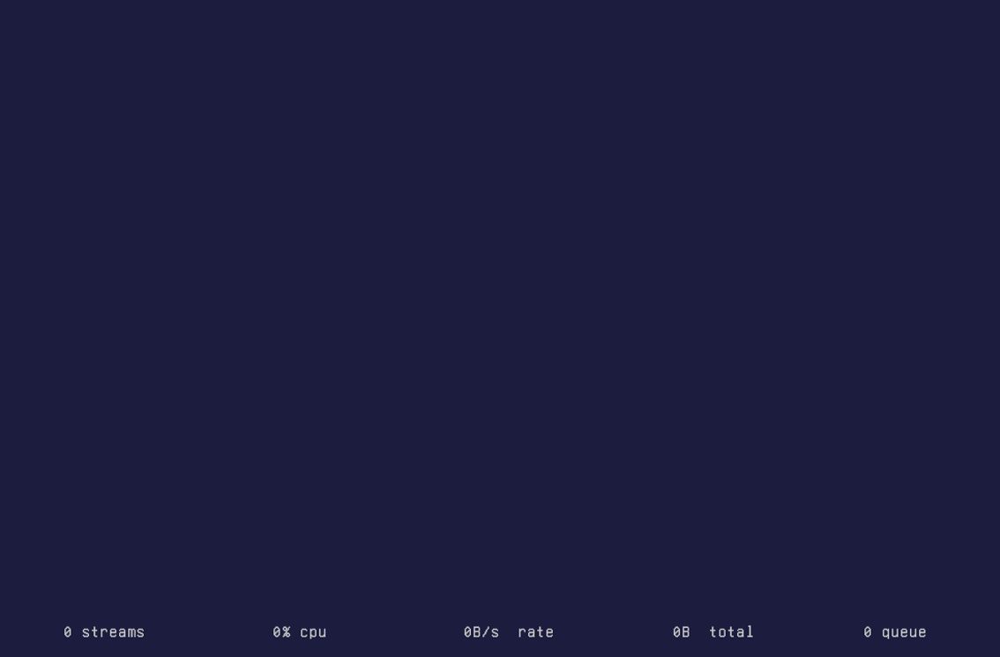

# TOTS
### Thoughts On Terminal Screen

TOTS is a terminal screensaver for [Hermes Agent](https://github.com/NousResearch/hermes-agent). It listens to the agent's reasoning, responses, and tool activity in real time, turning them into animated pixelated emojis.

Inspired by the title sequences of *Love, Death & Robots*, TOTS works as a passive visual activity indicator. While the agent is working, the display keeps moving. When activity stops, the animation gradually settles into sleep.

It's designed to sit quietly on a spare monitor, an old laptop, or a display somewhere on your desk or homelab, letting you know when your agent is busy without having to watch logs or interrupt your work.


## Features

- Monitors reasoning, text output, and tool execution from Hermes Agent.
- Supports multiple sessions, channels, and subagents.
- Includes a customizable phrase-to-emoji dictionary for DeepSeek V4.1 Flash.
- Simple string matching by default, with support for pluggable converters.
- Unicode pixel graphics and ASCII rendering.
- Built-in demo mode, stream simulation, debugging, and emoji previews.
- Runs offline without additional AI inference.
- Works in local terminals and over SSH.
- Linux virtual terminal and systemd service support.

## Requirements

- Linux or macOS (Windows has not been tested).
- Python 3.
- A terminal supporting ANSI colors.
- Hermes Agent installed and available in `PATH` for plugin installation and live monitoring.

No graphical environment is required.

## Installation

Clone the repository and install the Hermes plugin:

`make install`

This creates a symlink to the stream-tap plugin in the Hermes plugins directory, enables it, and offers to restart the gateway.

To update or remove the integration:

- `make update` — Update the plugin installation.
- `make uninstall` — Disable and remove the plugin.

## Usage

Run TOTS in the current terminal:

`make run`

Or directly:

`python3 main.py`

Use ASCII rendering instead of Unicode blocks:

`python3 main.py --ascii`

Start TOTS on a dedicated Linux virtual terminal:

`make run-vt`

Stop the running screensaver:

`make stop`

### Keyboard controls

| Key | Action |
|-----|--------|
| `q` | Quit |
| `Space` | Pause / resume |
| `D` | Toggle demo mode |
| `d` | Toggle debug information |
| `t` / `T` | Change theme |
| `p` / `P` | Change theme |
| `0–9` | Trigger random emojis |

### Run as a service

TOTS can run as a systemd service on Linux, making it suitable for an always-on computer with a dedicated display.

- `make install-service` — Install the `tots-screensaver` service.
- `make uninstall-service` — Remove the service.
- `make install-service ARGS="--ascii"` — Install the `tots-screensaver` service with a custom parameter.



## Try it without Hermes

You can explore TOTS without having Hermes Agent installed or running.

There are two ways to do this:

**Demo mode** generates random emoji animations without any external input:

`python3 main.py --demo`

**Mock stream** simulates Hermes activity by sending events through the same socket interface used by the plugin.

Start TOTS normally, then run the mock stream in another terminal:

`make mock-stream` (three sessions by default; use `make mock-stream ARGS="--sessions 5"` to change the count)

Unlike demo mode, this exercises the actual streaming and matching pipeline, making it useful for testing changes.

## Customizing thoughts

TOTS uses `assets/thoughts.csv` to associate phrases with emojis.

| thought | emoji |
|---------|-------|
| let me check | 🔍 🧐 🤔 |
| but wait | 😯 🤨 😳 |
| let me think | 🤔 💭 🧐 |

The default matcher uses literal string matching near sentence and paragraph boundaries, examining a configurable number of words (three by default).

When a match is found, the corresponding emojis are added to the animation queue.

You can edit the dictionary, add new expressions, remove unwanted matches, or use a different CSV:

`python3 main.py --csv suggestions.csv`

### Generate phrase suggestions

The included `suggest.py` analyzes Hermes conversation history stored in `~/.hermes/state.db`.

It extracts frequently occurring n-grams from the model's reasoning output and generates candidate phrases:

`make suggest`

The resulting `suggestions.csv` is a starting point, not a finished dictionary.

You can curate it manually or with the help of an LLM: select meaningful expressions, remove generic grammatical fragments, and assign one or more relevant emojis to each phrase.

Example prompt:
```
Curate `suggestions.csv`, mapping each phrase in the `thought` column to 0–5 emojis in the `emoji` column.

- Be creative and diverse. Use facial expressions when they match, but prefer objects, animals, food, and other metaphors drawn from every main emoji category.
- Map both literal and abstract meanings, including unconventional associations when they are intuitive or interesting.
- Avoid repetitive mappings. Use varied emojis to distinguish different thoughts, reactions, and intentions.
- Remove rows containing extremely generic grammatical fragments or phrases with no meaningful visual interpretation.
- Use fewer emojis when appropriate, including none if the phrase is meaningful but has no suitable representation.
- When unsure whether an emoji is present in the font, validate it with `python3 main.py --render 'EMOJI' >/dev/null 2>&1 && echo "OK" || echo "MISSING"`. You can omit the redirection to inspect the rendered glyphs visually.
- Preserve the CSV format and existing meaningful phrases. You may improve existing mappings and remove unsuitable entries.

The goal is a visually expressive, varied dictionary that makes an AI agent's reasoning stream interesting to watch without requiring literal interpretations.
```

The bundled dictionary was developed using reasoning traces from DeepSeek V4.1 Flash. Other models may use different expressions, so generating a model-specific dictionary can improve matching.

Contributions with additional phrases, corrections, and improved emoji mappings are welcome.

### Preview emojis

You can render individual emojis to inspect how they appear in the terminal:


This is useful for checking glyph compatibility and refining your selections before using them in animations.

## Custom converters

TOTS supports external Python functions for converting incoming text into emojis.

The default converter uses literal phrase matching against the CSV, but you can implement your own logic.

A converter receives a text fragment containing a configurable number of words (three by default) and returns a string containing zero or more emojis.

A simple example, included in `tools/example.py`:

```python
def convert(text):
  return ''.join(
    emoji for word, emoji in (
        ('but', '❌'), ('actually', '❌'), ('good', '✅'), ('fine', '✅')
    ) if word in text.casefold()
  )
```

Load it with:

`python3 main.py --converter tools.example:convert`

Converters can be as simple as keyword checks, or they can use more advanced techniques, such as semantic embeddings or lightweight local decision and classification models.

The animation system remains independent of how emojis are selected.

## Themes

TOTS supports customizable terminal color themes.

For example:

`python3 main.py --theme blwh+whcy+gn+yl+`

The six color positions define:

`background · foreground · info · debug · thought · output`

Using the following ANSI color mapping, with an optional `+` for the `bright` modifier:

| Token | Color              | Token | Color    |
| ----- | ------------------ | ----- | -------- |
| `fg`  | default foreground | `yl`  | yellow   |
| `bg`  | default background | `bl`  | blue     |
| `bk`  | black              | `mg`  | magenta  |
| `rd`  | red                | `cy`  | cyan     |
| `gn`  | green              | `wh`  | white    |

Themes can also be changed interactively while TOTS is running.

### Preview themes

`assets/vhs/themes.tape` prints an ANSI color swatch with `printf` and captures it with VHS's `Screenshot` command. The tape has no `Output` directive, so only the PNG is produced (no GIF or MP4).

VHS only honors `Set` directives placed at the top of a tape, so a single tape renders one theme. To capture the swatch for every VHS theme, run:

`make themes`

This rewrites the theme and screenshot directives for each theme and writes `assets/vhs/themes/<theme>.png`. Use `make themes ARGS="Dracula Nord"` to render a subset.

## How it works

The Hermes stream-tap plugin monkey-patches the `AIAgent` class from `run_agent` at runtime, wrapping the text and reasoning streaming callbacks.

It captures text and reasoning deltas, along with tool execution events, and publishes them through a local datagram socket.

Four event types are used: 

- `T` — Text delta
- `R` — Reasoning delta
- `S` — Tool start
- `E` — Tool end

Each session shares one active buffer between reasoning and responses, cleared when the channel changes. In debug mode, the free space above and below the slots is tiled according to the session count. Reasoning, responses, and tools share each session cell; matched phrases are highlighted in reverse video. Each cell wraps text to its width and shows the newest lines. Activity from multiple sessions and subagents can be monitored simultaneously. You can see the inner workings using debug mode (type `d` or use `--debug`).


Text fragments are passed to the configured converter. Matching phrases produce emojis that are placed into an animation queue.

The terminal renderer distributes these emojis across three scrolling cells, varying their timing, placement, and color inversion.

When activity fades, the display transitions into a sleeping state. Once the animation stops, the screen remains still until new activity arrives.

## Inspiration

TOTS started as an experiment in giving an AI agent a face, inspired by GERTY from *Moon* (2009).

A single face, however, offered a limited range of expressions and didn't map particularly well to a continuous reasoning stream. Emojis seemed more interesting: they provided a much larger visual vocabulary and could represent different thoughts and reactions as they appeared.

The animated title sequences of *Love, Death & Robots* eventually provided the inspiration for the scrolling, mechanical display.

The first prototype was written in Python using Tkinter. Performance was poor, and even after some optimizations and the introduction of a pixelated bitmap font (GNU Unifont), the graphical approach felt unnecessarily heavy.

The project was eventually moved entirely to the terminal, improving performance and portability while preserving its distinctive visual style.

The result gives an agent a little personality without turning it into another technical monitoring dashboard.

## License

TOTS is free software released under the GNU General Public License version 2 (GPL-2.0-only).

See [LICENSE](LICENSE) for details.
